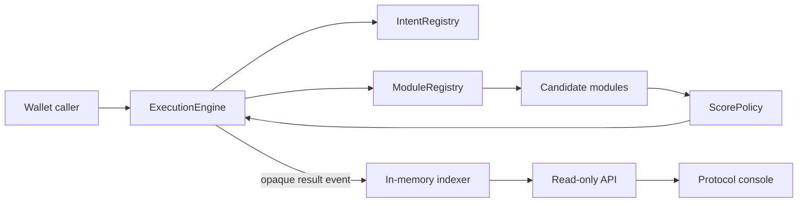
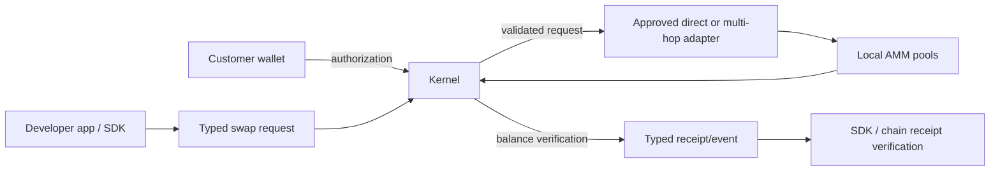

# System overview

## Current — verified local architecture

`ExecutionEngine` accepts opaque `(intentType, intentData)` from `msg.sender`, checks the active intent and active modules, simulates candidates, scores them, and executes the highest scorer. `RouterModule` and `MevProtectionModule` return placeholder encoded data; they do not perform ERC-20 settlement. The SDK submits through a caller wallet. The indexer stores events in memory; the API exposes read-only endpoints for one configured deployment.

The current engine provides neither signed per-operation authorization nor verified settlement. See [CURRENT_STATE.md](../planning/CURRENT_STATE.md).

## First Verified Execution MVP — proposed local architecture

This local MVP ends at authoritative on-chain settlement evidence. It does not
require a durable indexer, Cloud API, project records, or managed dashboard.
The Kernel validates authorization and constraints; adapters only execute an
already validated route.

## Post-MVP — proposed execution infrastructure and Cloud

After verified swap semantics and typed events are established, durable
indexing can provide canonical history and status. Cloud can then add
project-scoped visibility and policy workflows. Cloud prepares and observes;
it must not gain authority to alter a customer-authorized operation. These are
M4/M5 concerns, not First Verified Execution acceptance criteria.

## Migration considerations

Preserve useful decomposition (registries, engine, SDK wiring, event observation) while replacing opaque intent/result semantics. ScorePolicy is not a verified-swap prerequisite. The present module registry’s global active flag and the single-owner governance model require review before adapter governance or multi-tenant claims. Existing B2B documentation describes a one-kernel-per-customer approach as settled; this knowledge base treats tenancy as open. See [ADR index](ADR/index.md).
